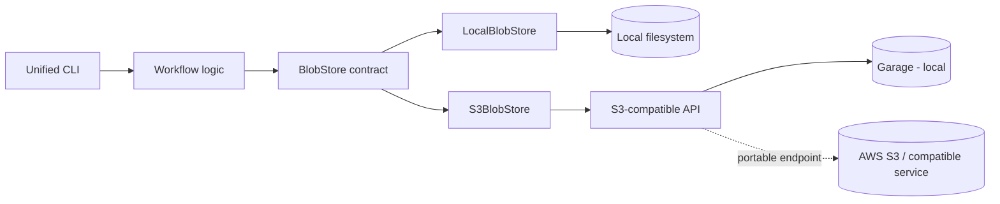

# Data Platform Lab

A hands-on data-engineering laboratory implemented in Python and JavaScript. The repository starts from dependency-light implementations of core pipeline patterns and is evolving into a small local data platform behind explicit application contracts.

Milestone 3 adds optional infrastructure adapters without making those vendors part of the workflow architecture.

## Platform architecture



The important boundary is `workflow logic -> platform contracts -> adapters`. Workflows do not import Garage-specific APIs, boto3, or AWS SDK clients directly.

## Run the core demos

```bash
# Python
cd python
poetry install
poetry run python -m data_platform_lab.demo

# JavaScript
cd javascript
corepack enable && yarn install
node src/demo.js
```

The sensor demo exercises orchestration, validation, deduplication, hourly aggregation, dead-letter routing, and run metadata.

```bash
# Python
cd python && poetry run python -m data_platform_lab.sensor_demo

# JavaScript
cd javascript && node src/sensor-demo.js
```

## Local S3-compatible platform

Milestone 3 introduces a common object-storage boundary. The local integration stack uses Garage as a disposable S3-compatible service. The image is pinned in `compose.yaml`, and deterministic development-only credentials are kept under `infra/garage/` so the stack can be reproduced in CI and on a laptop.

```bash
sh infra/garage/bootstrap.sh
```

Run the same storage smoke contract from either runtime:

```bash
# Python
cd python
. ../infra/garage/dev.env
poetry install
poetry run data-platform-lab storage --backend s3

# JavaScript
cd javascript
. ../infra/garage/dev.env
corepack enable && yarn install
node src/cli/main.js storage --backend s3
```

See [S3-compatible object storage](docs/s3-object-storage.md) for architecture and local setup.

## What is implemented

| # | Exercise | Key concepts |
| --- | --- | --- |
| 01 | CSV ingestion | Header standardisation, deduplication, bronze writes |
| 02 | API ingestion | Pagination, retries, raw and processed outputs |
| 03 | Validation framework | Composable rules, severity, pass/fail gating |
| 04 | Incremental ETL | Checkpoints, idempotent reruns, new-record processing |
| 05 | Snapshot diff / CDC | Inserts, updates, and deletes between snapshots |
| 06 | Orchestration runner | Sequential execution, retry logic, shared context |
| 07 | Observability | Timing, counters, run metadata, structured reports |
| 08 | Streaming processor | Event-time watermarks, lateness, dead-letter routing |
| 09 | Benchmark runner | Sequential, concurrent, and asynchronous ingestion |

Supporting platform capabilities include SQLite warehouse ELT, config precedence, shared manifests, a unified CLI, local and S3-compatible object-store adapters, and live S3 integration checks.

## Canonical registry ingestion

The Python platform can now consume the v1 SHA-pinned handoff emitted by
[`DiogoRibeiro7/data`](https://github.com/DiogoRibeiro7/data) without committing
source payloads or selecting a database provider. With an exact Git checkout
of the registry and its JSON handoff manifest:

```bash
cd python
data-platform-lab registry-ingest \
  --manifest ../data/manifests/canonical-handoff.json \
  --registry-root /path/to/pinned/data-checkout \
  --backend local \
  --root ../data/object-store \
  --receipt-dir ../data/manifests
```

The command verifies the checkout commit, source SHA-256, and destination
contents, then writes a lineage receipt. Repeating it reuses identical objects;
corrupt objects stop the run. The same workflow can target the existing S3
adapter via `--backend s3` when a supplier is chosen. See
[canonical ingestion guide](docs/registry-handoff-ingestion.md) for a complete
handoff generation example, limitations, and tests.

## DuckDB/Parquet analytical layer

The first curated consumer uses the approved ONS gross median weekly pay
dataset. It conserves suppressed/unavailable values, validates source grain and
confidence intervals, and materializes a typed Silver table plus two Gold
tables (unweighted geography-year distributions and nominal local-authority
year-on-year changes). Every Parquet output is tied to the input's source hash,
Git commit, and a versioned SQL model.

```bash
cd python
poetry install --extras analytics
poetry run data-platform-lab ons-pay-curate \
  --receipt ../data/manifests/registry_handoff_ingestion_<run-id>.json \
  --object-root ../data/object-store \
  --output-root ../data
```

See [the ONS pay analytical walkthrough](docs/ons-pay-analytics.md) for the
lineage, SQL models, quality gates, actual ONS data coverage, and limitations.
The core platform does not require DuckDB unless the optional analytics extra
or this command is used.

## Read-only analytical serving API

An optional local FastAPI service exposes those curated Gold Parquet tables
through a stable, supplier-neutral contract. Clients select a **full registry
commit and source SHA-256**; the service verifies the published curation receipt
and output hashes before reading. A safe replay does not create a new vintage.

```bash
cd python
poetry install --extras serving
poetry run data-platform-lab ons-pay-serve --data-root ../data
# GET http://127.0.0.1:8000/v1/ons-pay/vintages
```

See [the serving API contract](docs/ons-pay-serving.md) for endpoints,
filters, pagination, integrity and safety boundaries, and offline tests.
It requires no hosted database and binds to loopback by default (no auth).

## Pinned refresh and historical backfill

The ONS pay pipeline now has a single machine-invokable refresh command. It
checks upstream retrieval age against an optional SLA, verifies a canonical
handoff against its exact Git checkout, ingests the immutable raw object,
curates the Silver/Gold Parquet tables, and writes a success/failure audit.
Repeat `--source` pairs to backfill historical snapshots; reruns check and
reuse previously published outputs without changing the serving API's pins.

```bash
cd python
poetry install --extras serving
poetry run data-platform-lab ons-pay-refresh \
  --source ../data/manifests/ons-handoff.json /path/to/pinned/data-checkout \
  --object-root ../data/object-store --output-root ../data
```

See [the refresh and backfill guide](docs/ons-pay-refresh.md) for the read-only
dry run, freshness SLA, batch recovery, audit schema, and limits. Source
discovery and scheduling remain explicit rather than silently switching to
a floating dataset version.

## Operational health and freshness alerts

The read-only `ons-pay-monitor` command validates one explicitly pinned
vintage's Silver/Gold table contracts and refresh audit history. It reports
source retrieval age, time since the last successful refresh, missing-pay
share, and the latest overall batch outcome. JSON and Prometheus-style
metrics are available, with exit code `1` when a threshold or integrity check
fails. A [cron template](docs/examples/ons-pay-ops.crontab.example) illustrates
local scheduling but is not activated automatically.

```bash
cd python
poetry run data-platform-lab ons-pay-monitor \
  --data-root ../data --registry-commit COMMIT_SHA40 \
  --source-sha256 SOURCE_SHA256 --max-source-age-days 365 \
  --max-refresh-age-hours 30 --max-missing-pay-percent 5
```

See [the operational monitoring guide](docs/ons-pay-monitoring.md) for check
semantics, machine-readable metrics, exit codes and scheduling boundaries.

For a deployed metrics stack, an **explicit `--format prometheus --textfile
/path/ons-pay.prom`** option publishes an atomic scrape file, including a
last-evaluation timestamp for stale-run detection. The repository also provides
sample [Prometheus alert rules and a Grafana dashboard](docs/ons-pay-alerting.md)
for manual import. These templates do not start services, send notifications,
schedule runs, or select a database provider.

## Reproducible candidate release comparison

The read-only `ons-pay-compare` command evaluates the differences between two
explicitly pinned ONS pay vintages before an operator considers publication.
It verifies both Silver/Gold contracts, then uses a null-safe full outer join
on area code and reference date to distinguish added, removed, revised and
unchanged observations. Optional thresholds gate unexpected row churn,
new missing pay, and increases in the missing-pay percentage. It never
silently chooses `latest` or activates a deployment.

```bash
cd python
poetry run data-platform-lab ons-pay-compare \
  --data-root ../data \
  --baseline-registry-commit BASELINE_COMMIT_SHA40 \
  --baseline-source-sha256 BASELINE_SOURCE_SHA256 \
  --candidate-registry-commit CANDIDATE_COMMIT_SHA40 \
  --candidate-source-sha256 CANDIDATE_SOURCE_SHA256 \
  --max-removed-rows 0 --max-newly-missing-pay-rows 0
```

See the [release comparison contract](docs/ons-pay-release-comparison.md) for
policy semantics, null handling, examples, reproducibility and CLI exit codes.

## Manual release activation and rollback

The `ons-pay-release` CLI makes the final release decision explicit. An
operator previews a curated candidate, then deliberately adds `--apply` to
advance a single active-vintage pointer. The first activation requires
`--bootstrap`; later promotions require **all six** release-comparison
thresholds to pass. Each change creates a SHA-linked immutable decision record
with a reason and generation number, and rollback can restore a previously
active, still-verified vintage. A stale generation or failed quality gate
cannot silently switch the active pin.

```bash
cd python
# Safe and read-only without an existing active release:
poetry run data-platform-lab ons-pay-release --data-root ../data status

# Preview a first activation; add --apply only after reviewing the result:
poetry run data-platform-lab ons-pay-release --data-root ../data activate \
  --candidate-registry-commit COMMIT_SHA40 \
  --candidate-source-sha256 SOURCE_SHA256 \
  --expected-generation 0 --bootstrap --reason "Initial release"
```

The optional read-only `GET /v1/ons-pay/releases/active` endpoint lets clients
discover this manually selected vintage. All existing data queries **still
require exact pins**; nothing is deployed, scheduled, or automatically selected.
See the [manual release lifecycle guide](docs/ons-pay-release-lifecycle.md)
for promotion policy, rollback, audit durability, and limitations. The database
supplier choice remains open.

### Active-release health and rollback advice

The read-only `ons-pay-release assess` action evaluates the manually activated
pin with the existing integrity, freshness, missing-pay and refresh-audit
checks. It emits a generation-bound report and may recommend **reviewing** an
earlier activated vintage only when the active missing-pay SLA fails and that
earlier vintage passes the same health checks plus rollback preflight.
Corruption, freshness problems and shared refresh failures lead to an
investigation recommendation, not an automatic version switch.

```bash
poetry run data-platform-lab ons-pay-release --data-root ../data assess \
  --max-source-age-days 365 --max-refresh-age-hours 30 \
  --max-missing-pay-percent 5
```

The command can print Prometheus gauges or explicitly export an atomic
`.prom` textfile. Nothing schedules a run or executes a rollback. See the
[active-release health guide](docs/ons-pay-release-health.md) for decision
rules, failure handling, metrics, and tests.

## Unified CLI

```text
data-platform-lab benchmark ...
data-platform-lab ons-pay-compare ...
data-platform-lab ons-pay-curate ...
data-platform-lab ons-pay-monitor ...
data-platform-lab ons-pay-refresh ...
data-platform-lab ons-pay-release ...
data-platform-lab ons-pay-serve ...
data-platform-lab registry-ingest ...
data-platform-lab storage ...
data-platform-lab stream ...
data-platform-lab warehouse ...
```

The root CLI delegates to the existing workflow CLIs rather than duplicating their arguments.

## Quickstart

### Prerequisites

- Python 3.11+ and Poetry
- Node.js 22+ and Corepack/Yarn
- SQLite 3.35+ for warehouse exercises
- Docker Compose for the optional local infrastructure stack

### Tests

```bash
# Python
cd python
poetry install --extras serving
poetry run pytest
poetry run ruff check .
poetry run mypy src/

# JavaScript
cd javascript
corepack enable
yarn install
yarn test
yarn lint
```

## Data architecture

Data examples still follow the medallion model: raw, bronze, silver, gold, checkpoints, and manifests. Milestone 3 changes how platform services are reached; it does not discard the dependency-light educational workflows.

## Technology stack

| Area | Tools |
| --- | --- |
| Python | Poetry, pytest, Ruff, mypy strict, boto3 for S3 access |
| JavaScript | Yarn, Node.js test runner, ESLint, AWS SDK v3 for S3 access |
| SQL | SQLite today; PostgreSQL is the next M3 metadata-store step |
| Object storage | Local filesystem or S3-compatible API; Garage for local integration |
| CI | GitHub Actions, including a live S3 integration workflow |

## Milestones

- [Milestone 3](docs/milestone-m3.md) — local platform contracts and infrastructure adapters.
- [Milestone 2](docs/milestone-m2.md) — streaming, warehouse, benchmarks, config, manifests.
- [Milestone 1](docs/milestone-m1.md) — core exercises and the e-commerce workflow.

The next Milestone 3 slice is a PostgreSQL-backed run and metadata store, followed by Iceberg analytical tables and a broker-backed streaming adapter.

Additional documentation is indexed in [docs/exercise-index.md](docs/exercise-index.md) and [docs/roadmap.md](docs/roadmap.md).

## License

[MIT](LICENSE)
