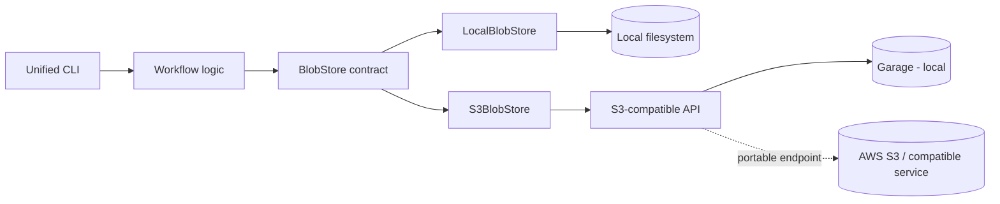

# Data Platform Lab

A hands-on data-engineering laboratory implemented in Python and JavaScript. The repository starts from dependency-light implementations of core pipeline patterns and is evolving into a small local data platform behind explicit application contracts.

Milestone 3 adds optional infrastructure adapters without making those vendors part of the workflow architecture.

## Platform architecture



The important boundary is `workflow logic -> platform contracts -> adapters`. Workflows do not import Garage-specific APIs, boto3, or AWS SDK clients directly.

## Run the core demos

```bash
# Python
cd python
poetry install
poetry run python -m data_platform_lab.demo

# JavaScript
cd javascript
corepack enable && yarn install
node src/demo.js
```

The sensor demo exercises orchestration, validation, deduplication, hourly aggregation, dead-letter routing, and run metadata.

```bash
# Python
cd python && poetry run python -m data_platform_lab.sensor_demo

# JavaScript
cd javascript && node src/sensor-demo.js
```

## Local S3-compatible platform

Milestone 3 introduces a common object-storage boundary. The local integration stack uses Garage as a disposable S3-compatible service. The image is pinned in `compose.yaml`, and deterministic development-only credentials are kept under `infra/garage/` so the stack can be reproduced in CI and on a laptop.

```bash
sh infra/garage/bootstrap.sh
```

Run the same storage smoke contract from either runtime:

```bash
# Python
cd python
. ../infra/garage/dev.env
poetry install
poetry run data-platform-lab storage --backend s3

# JavaScript
cd javascript
. ../infra/garage/dev.env
corepack enable && yarn install
node src/cli/main.js storage --backend s3
```

See [S3-compatible object storage](docs/s3-object-storage.md) for architecture and local setup.

## What is implemented

| # | Exercise | Key concepts |
| --- | --- | --- |
| 01 | CSV ingestion | Header standardisation, deduplication, bronze writes |
| 02 | API ingestion | Pagination, retries, raw and processed outputs |
| 03 | Validation framework | Composable rules, severity, pass/fail gating |
| 04 | Incremental ETL | Checkpoints, idempotent reruns, new-record processing |
| 05 | Snapshot diff / CDC | Inserts, updates, and deletes between snapshots |
| 06 | Orchestration runner | Sequential execution, retry logic, shared context |
| 07 | Observability | Timing, counters, run metadata, structured reports |
| 08 | Streaming processor | Event-time watermarks, lateness, dead-letter routing |
| 09 | Benchmark runner | Sequential, concurrent, and asynchronous ingestion |

Supporting platform capabilities include SQLite warehouse ELT, config precedence, shared manifests, a unified CLI, local and S3-compatible object-store adapters, and live S3 integration checks.

## Canonical registry ingestion

The Python platform can now consume the v1 SHA-pinned handoff emitted by
[`DiogoRibeiro7/data`](https://github.com/DiogoRibeiro7/data) without committing
source payloads or selecting a database provider. With an exact Git checkout
of the registry and its JSON handoff manifest:

```bash
cd python
data-platform-lab registry-ingest \
  --manifest ../data/manifests/canonical-handoff.json \
  --registry-root /path/to/pinned/data-checkout \
  --backend local \
  --root ../data/object-store \
  --receipt-dir ../data/manifests
```

The command verifies the checkout commit, source SHA-256, and destination
contents, then writes a lineage receipt. Repeating it reuses identical objects;
corrupt objects stop the run. The same workflow can target the existing S3
adapter via `--backend s3` when a supplier is chosen. See
[canonical ingestion guide](docs/registry-handoff-ingestion.md) for a complete
handoff generation example, limitations, and tests.

## DuckDB/Parquet analytical layer

The first curated consumer uses the approved ONS gross median weekly pay
dataset. It conserves suppressed/unavailable values, validates source grain and
confidence intervals, and materializes a typed Silver table plus two Gold
tables (unweighted geography-year distributions and nominal local-authority
year-on-year changes). Every Parquet output is tied to the input's source hash,
Git commit, and a versioned SQL model.

```bash
cd python
poetry install --extras analytics
poetry run data-platform-lab ons-pay-curate \
  --receipt ../data/manifests/registry_handoff_ingestion_<run-id>.json \
  --object-root ../data/object-store \
  --output-root ../data
```

See [the ONS pay analytical walkthrough](docs/ons-pay-analytics.md) for the
lineage, SQL models, quality gates, actual ONS data coverage, and limitations.
The core platform does not require DuckDB unless the optional analytics extra
or this command is used.

## Unified CLI

```text
data-platform-lab benchmark ...
data-platform-lab ons-pay-curate ...
data-platform-lab registry-ingest ...
data-platform-lab storage ...
data-platform-lab stream ...
data-platform-lab warehouse ...
```

The root CLI delegates to the existing workflow CLIs rather than duplicating their arguments.

## Quickstart

### Prerequisites

- Python 3.11+ and Poetry
- Node.js 22+ and Corepack/Yarn
- SQLite 3.35+ for warehouse exercises
- Docker Compose for the optional local infrastructure stack

### Tests

```bash
# Python
cd python
poetry install
poetry run pytest
poetry run ruff check .
poetry run mypy src/

# JavaScript
cd javascript
corepack enable
yarn install
yarn test
yarn lint
```

## Data architecture

Data examples still follow the medallion model: raw, bronze, silver, gold, checkpoints, and manifests. Milestone 3 changes how platform services are reached; it does not discard the dependency-light educational workflows.

## Technology stack

| Area | Tools |
| --- | --- |
| Python | Poetry, pytest, Ruff, mypy strict, boto3 for S3 access |
| JavaScript | Yarn, Node.js test runner, ESLint, AWS SDK v3 for S3 access |
| SQL | SQLite today; PostgreSQL is the next M3 metadata-store step |
| Object storage | Local filesystem or S3-compatible API; Garage for local integration |
| CI | GitHub Actions, including a live S3 integration workflow |

## Milestones

- [Milestone 3](docs/milestone-m3.md) — local platform contracts and infrastructure adapters.
- [Milestone 2](docs/milestone-m2.md) — streaming, warehouse, benchmarks, config, manifests.
- [Milestone 1](docs/milestone-m1.md) — core exercises and the e-commerce workflow.

The next Milestone 3 slice is a PostgreSQL-backed run and metadata store, followed by Iceberg analytical tables and a broker-backed streaming adapter.

Additional documentation is indexed in [docs/exercise-index.md](docs/exercise-index.md) and [docs/roadmap.md](docs/roadmap.md).

## License

[MIT](LICENSE)
