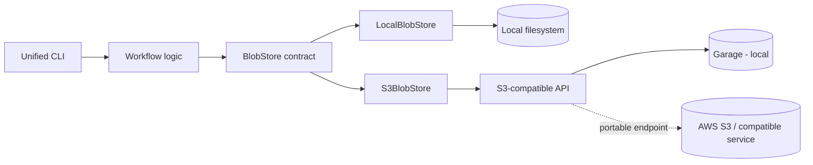

# Data Platform Lab

A hands-on data-engineering laboratory implemented in Python and JavaScript. The repository starts from dependency-light implementations of core pipeline patterns and is evolving into a small local data platform behind explicit application contracts.

Milestone 3 adds optional infrastructure adapters without making those vendors part of the workflow architecture.

## Platform architecture



The important boundary is `workflow logic -> platform contracts -> adapters`. Workflows do not import Garage-specific APIs, boto3, or AWS SDK clients directly.

## Run the core demos

Start each Python or JavaScript example from the repository root.

### E-commerce demo

The [e-commerce demo](docs/end-to-end-demo.md) cleans four related datasets and writes curated CSVs with a shared run manifest.

```bash
# Python
cd python
poetry install
poetry run python -m data_platform_lab.demo

# JavaScript
cd javascript
corepack enable && yarn install
node src/demo.js
```

### Sensor demo

The [sensor demo](docs/sensor-pipeline-demo.md) exercises orchestration, validation, deduplication, hourly aggregation, dead-letter routing, and run metadata.

```bash
# Python
cd python && poetry run python -m data_platform_lab.sensor_demo

# JavaScript
cd javascript && node src/sensor-demo.js
```

### Warehouse CLI

The [warehouse CLI](docs/warehouse-cli.md) loads the sample CSVs and events into a SQLite star schema, applies warehouse transforms, and writes analytical reports to `data/gold/warehouse/`. These commands use an in-memory database by default.

```bash
# Python
cd python
poetry run data-platform-lab warehouse

# JavaScript
cd javascript
node src/cli/main.js warehouse
```

The streaming, warehouse, and benchmark CLIs also accept `--config` with JSON settings from [configs/](configs/). Explicit CLI flags override config values, which override built-in defaults. Paths inside the config are relative to the working directory; the bundled configs use repository-root paths. See [config-driven workflows](docs/config-driven-workflows.md) for supported keys and precedence.

## Local S3-compatible platform

Milestone 3 introduces a common object-storage boundary. The local integration stack uses Garage as a disposable S3-compatible service. The image is pinned in `compose.yaml`, and deterministic development-only credentials are kept under `infra/garage/` so the stack can be reproduced in CI and on a laptop.

```bash
sh infra/garage/bootstrap.sh
```

Run the same storage smoke contract from either runtime:

```bash
# Python
cd python
. ../infra/garage/dev.env
poetry install
poetry run data-platform-lab storage --backend s3

# JavaScript
cd javascript
. ../infra/garage/dev.env
corepack enable && yarn install
node src/cli/main.js storage --backend s3
```

See [S3-compatible object storage](docs/s3-object-storage.md) for architecture and local setup.

## What is implemented

Nine exercises are implemented in both Python and JavaScript:

| # | Exercise | Key concepts |
| --- | --- | --- |
| 01 | [CSV ingestion](docs/01-csv-ingestion-pipeline.md) | Header standardisation, deduplication, bronze writes |
| 02 | [API ingestion](docs/02-api-ingestion-pipeline.md) | Pagination, retries, raw and processed outputs |
| 03 | [Validation framework](docs/03-validation-framework.md) | Composable rules, severity, pass/fail gating |
| 04 | [Incremental ETL](docs/04-incremental-etl-pipeline.md) | Checkpoints, idempotent reruns, new-record processing |
| 05 | [Snapshot diff / CDC](docs/05-snapshot-diff.md) | Inserts, updates, and deletes between snapshots |
| 06 | [Orchestration runner](docs/06-orchestration-runner.md) | Sequential execution, retry logic, shared context |
| 07 | [Observability](docs/07-observability.md) | Timing, counters, run metadata, structured reports |
| 08 | [Streaming processor](docs/streaming-exercise.md) | Event-time watermarks, lateness, dead-letter routing |
| 09 | [Benchmark runner](docs/benchmark-exercise.md) | Sequential, concurrent, and asynchronous ingestion |

Supporting platform capabilities include SQLite warehouse ELT, config precedence, shared manifests, a unified CLI, local and S3-compatible object-store adapters, and live S3 integration checks.

## Repository layout

Selected directories for running and extending the exercises:

```text
data-platform-lab/
├── configs/                         # JSON workflow settings and ONS alert policies
├── data/sample/                     # Shared input fixtures
├── python/
│   ├── src/data_platform_lab/
│   │   ├── streaming/               # Event processing and streaming CLI
│   │   ├── warehouse/               # SQLite loading, transforms, and CLI
│   │   ├── benchmark/               # Ingestion strategies and benchmark CLI
│   │   └── cli/                     # Unified command dispatcher
│   └── tests/                       # Python tests
├── javascript/
│   ├── src/
│   │   ├── streaming/               # JavaScript streaming implementation
│   │   ├── warehouse/               # JavaScript warehouse implementation
│   │   ├── benchmark/               # JavaScript benchmark implementation
│   │   └── cli/                     # Unified command dispatcher
│   └── tests/                       # Node.js tests
├── sql/                             # Staging, warehouse, and analytics SQL
└── docs/                            # Exercise guides and platform contracts
```

## Canonical registry ingestion

The Python platform can now consume the v1 SHA-pinned handoff emitted by
[`DiogoRibeiro7/data`](https://github.com/DiogoRibeiro7/data) without committing
source payloads or selecting a database provider. With an exact Git checkout
of the registry and its JSON handoff manifest:

```bash
cd python
data-platform-lab registry-ingest \
  --manifest ../data/manifests/canonical-handoff.json \
  --registry-root /path/to/pinned/data-checkout \
  --backend local \
  --root ../data/object-store \
  --receipt-dir ../data/manifests
```

The command verifies the checkout commit, source SHA-256, and destination
contents, then writes a lineage receipt. Repeating it reuses identical objects;
corrupt objects stop the run. The same workflow can target the existing S3
adapter via `--backend s3` when a supplier is chosen. See
[canonical ingestion guide](docs/registry-handoff-ingestion.md) for a complete
handoff generation example, limitations, and tests.

## DuckDB/Parquet analytical layer

The first curated consumer uses the approved ONS gross median weekly pay
dataset. It conserves suppressed/unavailable values, validates source grain and
confidence intervals, and materializes a typed Silver table plus two Gold
tables (unweighted geography-year distributions and nominal local-authority
year-on-year changes). Every Parquet output is tied to the input's source hash,
Git commit, and a versioned SQL model.

```bash
cd python
poetry install --extras analytics
poetry run data-platform-lab ons-pay-curate \
  --receipt ../data/manifests/registry_handoff_ingestion_<run-id>.json \
  --object-root ../data/object-store \
  --output-root ../data
```

See [the ONS pay analytical walkthrough](docs/ons-pay-analytics.md) for the
lineage, SQL models, quality gates, actual ONS data coverage, and limitations.
The core platform does not require DuckDB unless the optional analytics extra
or this command is used.

## Read-only analytical serving API

An optional local FastAPI service exposes those curated Gold Parquet tables
through a stable, supplier-neutral contract. Clients select a **full registry
commit and source SHA-256**; the service verifies the published curation receipt
and output hashes before reading. A safe replay does not create a new vintage.

```bash
cd python
poetry install --extras serving
poetry run data-platform-lab ons-pay-serve --data-root ../data
# GET http://127.0.0.1:8000/v1/ons-pay/vintages
```

See [the serving API contract](docs/ons-pay-serving.md) for endpoints,
filters, pagination, integrity and safety boundaries, and offline tests.
It requires no hosted database and binds to loopback by default (no auth).

## Relational and document publishing

The [release-readiness checklist](docs/ons-pay-publishing-readiness.md) records
the supported execution paths, verification evidence and operational limits.
[Unreleased publishing notes](docs/ons-pay-publishing-release-notes.md) describe
the operator commands and recovery behavior.

Run the complete synthetic source-to-database walkthrough with local Docker:

```bash
python scripts/ons_pay_publishing_demo.py --exercise-recovery
```

It verifies real Git-pinned source bytes, curates Silver/Gold, publishes both
Gold tables to disposable PostgreSQL and MongoDB, checks idempotency, rejects
controlled drift and explicitly recovers. JSON reports, plans and durable
evidence remain in a fresh output directory after the services are removed.
See the [complete walkthrough and architecture](docs/ons-pay-publishing-demo.md)
for prerequisites, stage outcomes, artifact inspection and consistency limits.

Before choosing hosted SQL and NoSQL suppliers, the read-only
`ons-pay-publish-plan` command projects a verified, exact ONS pay Gold vintage
into either flat relational rows or nested documents. Both shapes have
identical deterministic record IDs, full lineage pins, preserved nulls and a
canonical batch fingerprint. It does not write to either type of database.

```bash
cd python
poetry run data-platform-lab ons-pay-publish-plan \
  --data-root ../data \
  --registry-commit COMMIT_SHA40 --source-sha256 SOURCE_SHA256 \
  --table local_authority_yoy --shape document
```

The [portable publishing guide](docs/ons-pay-portable-publishing.md)
documents the target shapes, natural keys, data contracts, trust boundaries
and offline verification. Explicit Python adapters now support transactional,
parameterized PostgreSQL upserts and idempotent MongoDB-style document
replacements using injected connections. There are **no automatic writes**,
hosted credentials or scheduled publication steps; the choice of hosting
supplier remains open. Read-only `reconcile_postgres` and `reconcile_mongodb`
functions compare a complete pinned sink vintage to the independently verified
plan, reporting missing, unexpected and altered records without exposing values.
An opt-in `accept_publication` gate now requires the write receipt and complete
read-back report to agree with that plan, including an independently recomputed
sink hash. `publish_and_accept_postgres` and `publish_and_accept_mongodb`
combine the explicit steps with injected handles. Acceptance does not advance
a release pointer or roll back writes that already committed.

The operator command `ons-pay-publish` combines these contracts. It requires
all source pins, a model version, table and sink. With no operation flag it
prints a summary preview without connecting to a sink or writing files:

```bash
poetry run data-platform-lab ons-pay-publish \
  --data-root ../data --model-version 1 \
  --registry-commit COMMIT_SHA40 --source-sha256 SOURCE_SHA256 \
  --table local_authority_yoy --sink postgresql
```

Set `ONS_PAY_POSTGRES_DSN`, then add `--apply` to publish and require acceptance,
or `--verify` to reconcile an existing vintage without writes. For `--sink mongodb`,
install the optional driver with `poetry install --extras "serving mongodb"`
and set `ONS_PAY_MONGODB_URI` and `ONS_PAY_MONGODB_DATABASE`.
Verification reports `verified`, never `accepted`.
Every operation emits JSON summaries without credentials or record values.
Exit codes are `0` success, `2` validation/configuration failure, `3`
reconciliation/acceptance rejection and `4` database failure. See the
[operator walkthrough](docs/ons-pay-portable-publishing.md#operator-publishing-cli)
for both sinks, error semantics and recovery.

To retain a publication outcome, add `--apply --record-evidence`. The command
records an immutable, content-addressed manifest with a UUID attempt ID;
`--attempt-id UUID` lets an operator retry the same recorded attempt without
repeating database writes. Use a new UUID for a new publication or recovery.
Inspect records with `data-platform-lab ons-pay-publication-history --data-root ../data`.
Durable writes require a local POSIX filesystem; inspection is read-only.
See [durable publication evidence](docs/ons-pay-portable-publishing.md#durable-publication-evidence)
for outcome semantics, persistence failures, concurrency and trust limits.

Real PyMongo integration is available through the optional `mongodb` Compose
profile, using MongoDB 9.0.4 with disposable storage and a loopback-only port.
The [local test commands](docs/ons-pay-portable-publishing.md#disposable-local-mongodb-integration)
exercise both Gold tables, idempotency, vintage isolation, drift, partial-write
recovery and durable outcomes. The same suite runs in CI without hosted
credentials. MongoDB batches remain non-atomic; recovery is explicit and
CLI-owned clients disable automatic driver retries.

## Pinned refresh and historical backfill

The ONS pay pipeline now has a single machine-invokable refresh command. It
checks upstream retrieval age against an optional SLA, verifies a canonical
handoff against its exact Git checkout, ingests the immutable raw object,
curates the Silver/Gold Parquet tables, and writes a success/failure audit.
Repeat `--source` pairs to backfill historical snapshots; reruns check and
reuse previously published outputs without changing the serving API's pins.

```bash
cd python
poetry install --extras serving
poetry run data-platform-lab ons-pay-refresh \
  --source ../data/manifests/ons-handoff.json /path/to/pinned/data-checkout \
  --object-root ../data/object-store --output-root ../data
```

See [the refresh and backfill guide](docs/ons-pay-refresh.md) for the read-only
dry run, freshness SLA, batch recovery, audit schema, and limits. Source
discovery and scheduling remain explicit rather than silently switching to
a floating dataset version.

## Operational health and freshness alerts

The read-only `ons-pay-monitor` command validates one explicitly pinned
vintage's Silver/Gold table contracts and refresh audit history. It reports
source retrieval age, time since the last successful refresh, missing-pay
share, and the latest overall batch outcome. JSON and Prometheus-style
metrics are available, with exit code `1` when a threshold or integrity check
fails. A [cron template](docs/examples/ons-pay-ops.crontab.example) illustrates
local scheduling but is not activated automatically.

```bash
cd python
poetry run data-platform-lab ons-pay-monitor \
  --data-root ../data --registry-commit COMMIT_SHA40 \
  --source-sha256 SOURCE_SHA256 --max-source-age-days 365 \
  --max-refresh-age-hours 30 --max-missing-pay-percent 5
```

See [the operational monitoring guide](docs/ons-pay-monitoring.md) for check
semantics, machine-readable metrics, exit codes and scheduling boundaries.

For a deployed metrics stack, an **explicit `--format prometheus --textfile
/path/ons-pay.prom`** option publishes an atomic scrape file, including a
last-evaluation timestamp for stale-run detection. The repository also provides
sample [Prometheus alert rules and a Grafana dashboard](docs/ons-pay-alerting.md)
for manual import. These templates do not start services, send notifications,
schedule runs, or select a database provider.

## Reproducible candidate release comparison

The read-only `ons-pay-compare` command evaluates the differences between two
explicitly pinned ONS pay vintages before an operator considers publication.
It verifies both Silver/Gold contracts, then uses a null-safe full outer join
on area code and reference date to distinguish added, removed, revised and
unchanged observations. Optional thresholds gate unexpected row churn,
new missing pay, and increases in the missing-pay percentage. It never
silently chooses `latest` or activates a deployment.

```bash
cd python
poetry run data-platform-lab ons-pay-compare \
  --data-root ../data \
  --baseline-registry-commit BASELINE_COMMIT_SHA40 \
  --baseline-source-sha256 BASELINE_SOURCE_SHA256 \
  --candidate-registry-commit CANDIDATE_COMMIT_SHA40 \
  --candidate-source-sha256 CANDIDATE_SOURCE_SHA256 \
  --max-removed-rows 0 --max-newly-missing-pay-rows 0
```

See the [release comparison contract](docs/ons-pay-release-comparison.md) for
policy semantics, null handling, examples, reproducibility and CLI exit codes.

## Manual release activation and rollback

The `ons-pay-release` CLI makes the final release decision explicit. An
operator previews a curated candidate, then deliberately adds `--apply` to
advance a single active-vintage pointer. The first activation requires
`--bootstrap`; later promotions require **all six** release-comparison
thresholds to pass. Each change creates a SHA-linked immutable decision record
with a reason and generation number, and rollback can restore a previously
active, still-verified vintage. A stale generation or failed quality gate
cannot silently switch the active pin.

```bash
cd python
# Safe and read-only without an existing active release:
poetry run data-platform-lab ons-pay-release --data-root ../data status

# Preview a first activation; add --apply only after reviewing the result:
poetry run data-platform-lab ons-pay-release --data-root ../data activate \
  --candidate-registry-commit COMMIT_SHA40 \
  --candidate-source-sha256 SOURCE_SHA256 \
  --expected-generation 0 --bootstrap --reason "Initial release"
```

The optional read-only `GET /v1/ons-pay/releases/active` endpoint lets clients
discover this manually selected vintage. All existing data queries **still
require exact pins**; nothing is deployed, scheduled, or automatically selected.
See the [manual release lifecycle guide](docs/ons-pay-release-lifecycle.md)
for promotion policy, rollback, audit durability, and limitations. The database
supplier choice remains open.

### Active-release health and rollback advice

The read-only `ons-pay-release assess` action evaluates the manually activated
pin with the existing integrity, freshness, missing-pay and refresh-audit
checks. It emits a generation-bound report and may recommend **reviewing** an
earlier activated vintage only when the active missing-pay SLA fails and that
earlier vintage passes the same health checks plus rollback preflight.
Corruption, freshness problems and shared refresh failures lead to an
investigation recommendation, not an automatic version switch.

```bash
poetry run data-platform-lab ons-pay-release --data-root ../data assess \
  --max-source-age-days 365 --max-refresh-age-hours 30 \
  --max-missing-pay-percent 5
```

The command can print Prometheus gauges or explicitly export an atomic
`.prom` textfile. Nothing schedules a run or executes a rollback. See the
[active-release health guide](docs/ons-pay-release-health.md) for decision
rules, failure handling, metrics, and tests.

### Historical release-health trends

Add `--record` to `ons-pay-release assess` to explicitly archive a complete
health report as canonical, SHA-256-addressed JSON linked to the exact active
generation. The archive is append-only and can preserve incidents even when
the active curated Parquet has become untrusted. Without `--record`, assessment
still writes no archive data.

```bash
# Explicitly save an assessment (including failed checks).
poetry run data-platform-lab ons-pay-release --data-root ../data assess \
  --max-missing-pay-percent 5 --record

# Read-only trends, summaries and flat CSV export.
poetry run data-platform-lab ons-pay-release --data-root ../data trends --last 50
poetry run data-platform-lab ons-pay-release --data-root ../data trends \
  --generation 2 --last 100 --format csv
```

The [health-history guide](docs/ons-pay-release-health-history.md) documents
cross-generation lineage, deterministic transitions, CSV columns, append-only
durability and trust boundaries. No hosted database, scheduler, or automatic
rollback is introduced.

### History-based release quality alerts

Evaluate **opt-in** policies over verified, generation-pinned assessment
history. A mandatory check flags missing evidence for the currently active
generation; optional thresholds detect stale assessments, consecutive unhealthy
observations, unhealthy share, and adjacent/cumulative missing-pay-rate drift.
Unknown evidence is reported as `unavailable`, not silently counted as healthy.

```bash
poetry run data-platform-lab ons-pay-release --data-root ../data alerts \
  --last 50 --max-assessment-age-hours 36 --alert-after-unhealthy 3 \
  --max-missing-pay-increase-pp 3 --max-cumulative-missing-pay-drift-pp 8
```

The command is read-only by default, returns machine-readable JSON or
Prometheus gauges, and can atomically write a `.prom` file **only** with an
explicit `--format prometheus --textfile` destination. Versioned JSON
**policy-as-code** is also supported: validate a policy without any active
release, or evaluate it with explicit CLI overrides and a canonical fingerprint.

```bash
poetry run data-platform-lab ons-pay-release validate-alert-policy \
  --policy-file ../configs/ons-pay-alert-policy.example.json
poetry run data-platform-lab ons-pay-release --data-root ../data alerts \
  --policy-file ../configs/ons-pay-alert-policy.example.json
```

See the [history-alerting guide](docs/ons-pay-history-alerting.md) for policy details,
missing-evidence semantics, threshold examples, and offline tests. No provider,
scheduler, notification system or automatic release action is introduced.

### Replaying alert policies over historical releases

`ons-pay-release replay-alerts` re-evaluates a versioned policy at verified
historical assessment checkpoints. It keeps the complete preceding observation
window even when only a few recent checkpoints are requested, preventing
look-ahead leakage and truncated drift comparisons. Deterministic JSON and
flat CSV provide reproducible evidence for threshold review.

```bash
poetry run data-platform-lab ons-pay-release --data-root ../data replay-alerts \
  --policy-file ../configs/ons-pay-alert-policy.example.json \
  --replay-last 100 --format csv
```

The [historical replay guide](docs/ons-pay-history-replay.md) explains the
distinction between simulated assessment outcomes and real-time incident
detection, as well as policy fingerprints, exit codes, and offline tests.
Replay never schedules a job, pages an operator, writes a record, or changes
an active release.

### Comparing two historical alert policies

`ons-pay-release compare-alert-policies` evaluates two explicit, versioned
policies against the **same verified recorded checkpoints**. A deterministic
JSON report includes the full `ok`/`alert`/`unavailable` transition matrix,
changed check evidence and both policy fingerprints; flat paired CSV can be
used for offline review. A transition from `alert` to `unavailable` is never
misreported as a resolved alert.

```bash
poetry run data-platform-lab ons-pay-release --data-root ../data \
  compare-alert-policies \
  --baseline-policy-file ../configs/ons-pay-alert-policy.example.json \
  --candidate-policy-file ../configs/ons-pay-alert-policy.candidate.example.json \
  --replay-last 50 --format csv
```

The [paired comparison guide](docs/ons-pay-alert-policy-comparison.md)
explains checkpoint alignment, interpretation, evidence gaps, and integrity
checks. No supplier, service, schedule, persisted result or automatic action
is required.

For reproducible candidate review in CI, an optional **versioned acceptance
gate** checks the number of newly alerting, newly unavailable, and changed
checkpoints against explicit operator budgets. It includes a mandatory
minimum-evidence check and emits an auditable JSON verdict and exit code.

```bash
poetry run data-platform-lab ons-pay-release --data-root ../data \
  compare-alert-policies \
  --baseline-policy-file ../configs/ons-pay-alert-policy.example.json \
  --candidate-policy-file ../configs/ons-pay-alert-policy.candidate.example.json \
  --gate-file ../configs/ons-pay-alert-comparison-gate.example.json
```

The [comparison acceptance-gate guide](docs/ons-pay-alert-comparison-gates.md)
documents strict policy-as-code validation, counts, missing-evidence
semantics and read-only CI use. A gate never deploys an alert policy or
selects a database provider.

## Unified CLI

```text
data-platform-lab benchmark ...
data-platform-lab ons-pay-compare ...
data-platform-lab ons-pay-curate ...
data-platform-lab ons-pay-monitor ...
data-platform-lab ons-pay-refresh ...
data-platform-lab ons-pay-release ...
data-platform-lab ons-pay-serve ...
data-platform-lab registry-ingest ...
data-platform-lab storage ...
data-platform-lab stream ...
data-platform-lab warehouse ...
```

The root CLI delegates to the existing workflow CLIs rather than duplicating their arguments.

## Quickstart

### Prerequisites

- Python 3.11–3.14 and Poetry
- Node.js 22.13+ (22.x) or 24+ and Corepack/Yarn
- SQLite 3.35+ for warehouse exercises
- Docker Compose for the optional local infrastructure stack

### Tests

```bash
# Python
cd python
poetry install --extras serving
poetry run pytest
poetry run ruff check --config pyproject.toml . ../scripts
poetry run ruff format --config pyproject.toml --check . ../scripts
poetry run mypy src/ ../scripts

# JavaScript
cd javascript
corepack enable
yarn install
yarn test
yarn lint
```

## Data architecture

Data examples still follow the medallion model: raw, bronze, silver, gold, checkpoints, and manifests. Milestone 3 changes how platform services are reached; it does not discard the dependency-light educational workflows.

## Technology stack

| Area | Tools |
| --- | --- |
| Python | Poetry, pytest, Ruff, mypy strict, boto3 for S3 access |
| JavaScript | Yarn, Node.js test runner, ESLint, AWS SDK v3 for S3 access |
| SQL | SQLite exercises, PostgreSQL metadata/publishing, and DuckDB/Parquet analytics |
| Object storage | Local filesystem or S3-compatible API; Garage for local integration |
| CI | GitHub Actions with Python 3.11–3.14 tests, live platform integrations and the packaged ONS demo |

## Milestones

- [Milestone 3](docs/milestone-m3.md) — local platform contracts and infrastructure adapters.
- [Milestone 2](docs/milestone-m2.md) — streaming, warehouse, benchmarks, config, manifests.
- [Milestone 1](docs/milestone-m1.md) — core exercises and the e-commerce workflow.

The next Milestone 3 slice is a PostgreSQL-backed run and metadata store, followed by Iceberg analytical tables and a broker-backed streaming adapter.

Additional documentation is indexed in [docs/exercise-index.md](docs/exercise-index.md) and [docs/roadmap.md](docs/roadmap.md).

## License

[MIT](LICENSE)
