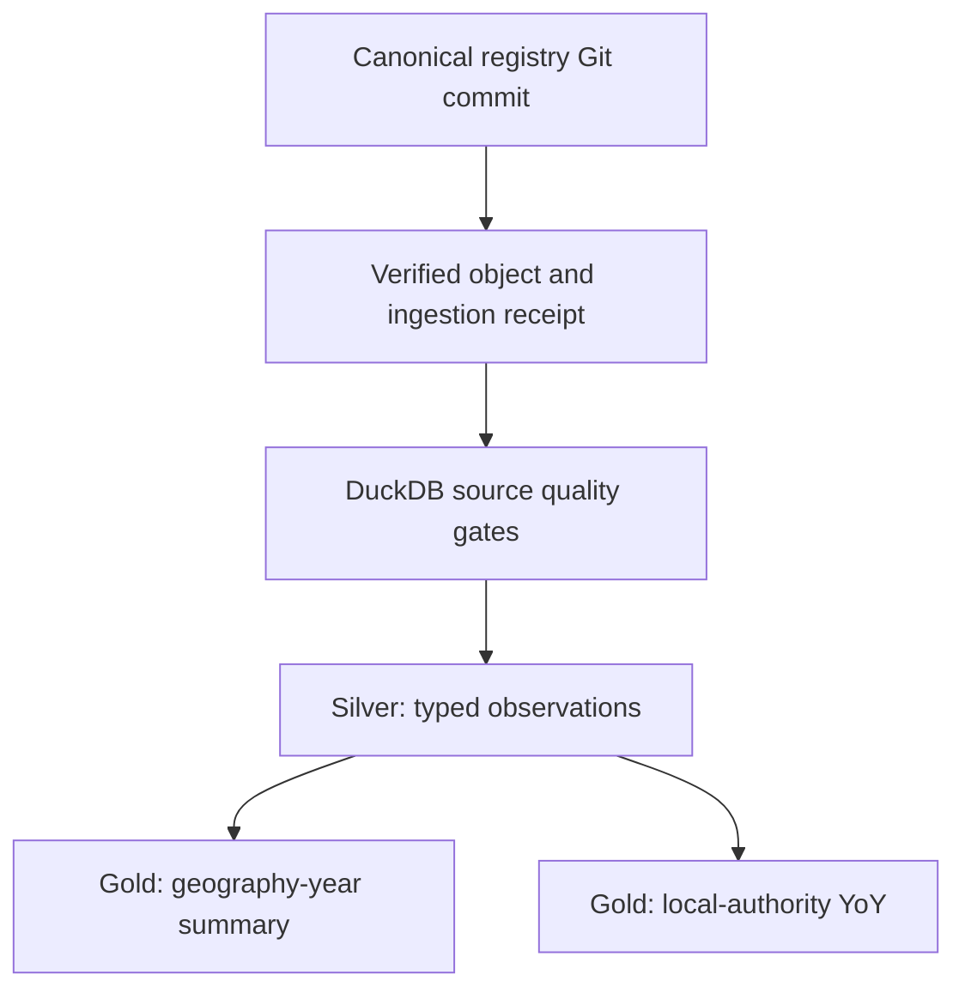

# ONS gross median weekly pay: curated analytical tables

This is the first real source-to-analytics consumer of the [canonical registry
handoff](registry-handoff-ingestion.md). It remains fully runnable on a laptop;
you do not need to choose Supabase, PostgreSQL hosting, object-storage billing,
or another supplier.

## Source and data-contract boundary

The canonical file comes from the [ONS Explore Local Statistics
source](https://github.com/ONSdigital/explore-local-statistics-data) and is
registered in [`DiogoRibeiro7/data`](https://github.com/DiogoRibeiro7/data/tree/main/datasets/ons-gross-median-weekly-pay).
Its registry metadata records the source snapshot and the Open Government
Licence v3.0. The CSV contains **7,109 observations**, **409 area codes**, and
**18 reference years (2008–2025)**. Of these, **129 do not report a numeric pay
value** and carry an upstream `x` or `u` status. We preserve those records
instead of imputing, suppressing, or discarding them.



The runtime accepts **only** a successful `registry_handoff_ingestion` receipt
for the exact canonical ONS CSV. Before parsing any CSV, it verifies the
stored object's source hash and byte count against the receipt. No source
network calls or writebacks to the canonical registry occur.

## Run the full local path

1. Follow [registry ingestion](registry-handoff-ingestion.md) to create an
   exact-commit handoff and run `data-platform-lab registry-ingest` with the
   local object store. Keep the resulting `receipt_path`.

2. Install the optional analytics dependency, then run the model:

   ```bash
   cd python
   poetry install --extras analytics
   poetry run data-platform-lab ons-pay-curate \
     --receipt ../data/manifests/registry_handoff_ingestion_<run-id>.json \
     --object-root ../data/object-store \
     --output-root ../data
   ```

3. Read the returned paths. For instance, using the Python DuckDB API:

   ```python
   import duckdb

   # Use the geography_year.parquet path from the curation command's output.
   summary = duckdb.read_parquet("/path/to/geography_year.parquet")
   summary.filter("geography = 'Local Authority District'").order("pay_year").show()
   ```

The standard output is a JSON object containing source row counts, the Silver
and Gold Parquet paths, publication/reuse status, and the analytical receipt.

## Tables and their exact meaning

| Layer | Table | Grain | Contract |
|---|---|---|---|
| Silver | `observations.parquet` | Area code × reference date | Typed reference date, year, nominal GBP per week, optional confidence bounds, upstream status/notes, SHA-256 and Git pin. No source rows are discarded. |
| Gold | `geography_year.parquet` | Geography *type* × year | Counts of areas with/without observed pay, and min/median/max across reported area pay values. The median is **unweighted**, not a national pay measure. |
| Gold | `local_authority_yoy.parquet` | Local authority × year | Reported weekly pay and nominal year-on-year percentage change, only when the previous record is exactly one year earlier and both amounts are observed. |

Source fields are not deduplicated automatically; a duplicate area/year is a
quality failure. `NULL` in confidence intervals is legitimate for reported
observations where ONS did not provide interval estimates. Missing pay remains
`NULL` with its original status code. Gold aggregates ignore missing pay but
report its count.

This pipeline does **not** claim that an unweighted median across overlapping
geographies is a UK-wide wage estimate. Growth is *nominal*, not
inflation-adjusted; it is not a causal or real-wage interpretation.

## Quality and reproducibility

Quality checks are expressed in
[`ons_pay_quality.sql`](../python/src/data_platform_lab/curation/sql/ons_pay_quality.sql).
All checks must pass before any Parquet file is published:

- Exact 12-column CSV header; missing or unexpected columns fail.
- Nonempty area identity and valid date, plus ONS indicator, measure and GBP unit.
- No duplicate area/year grain, invalid/non-finite numbers, negative pay, or
  inconsistent suppression status.
- Confidence bounds are both present or both absent. When present, the
  reported pay must lie within the interval.
- Silver must conserve the source row count. Exported Parquet counts must
  agree with their in-memory tables.

The transform SQL is under `python/src/data_platform_lab/curation/sql/`:

- `ons_pay_silver.sql` converts types and preserves missingness.
- `ons_pay_geography_year.sql` produces unweighted area summaries.
- `ons_pay_local_authority_yoy.sql` uses `LAG` with a strict adjacent-year rule.

Output keys include `v1`, the *full registry commit*, and the source SHA-256.
They live under `data/silver/` and `data/gold/` (ignored by Git). Every run
writes a separate atomic JSON execution receipt under `data/manifests/`,
with the ingestion receipt hash, source attribution/license, quality metrics,
and output file hashes. The same source/model rerun verifies and **reuses**
identical Parquet without rewriting it. Corrupt or unexpectedly changed
outputs fail closed. An intended SQL-semantic change requires advancing
`MODEL_VERSION` to preserve the previous analytical version.

## Tests and current limits

```bash
cd python
poetry run pytest tests/test_ons_pay_curation.py -q
poetry run ruff check src/ tests/
poetry run mypy src/
```

Synthetic fixtures build a real Git checkout, run the preceding ingestion
pipeline, then validate the DuckDB tables. Tests cover suppression, unweighted
summaries, year gaps, schema drift, invalid values, immutable output conflict,
tampered source objects, idempotent replay, and the CLI without cloud access.

The source `BlobStore` currently exposes `get_bytes`, so each raw object is
read into memory. Curation is single-writer and locally materialized; it is not
yet a distributed or transactional lakehouse. A later slice can introduce
streamed reads, destination abstraction, orchestration, model contracts, and
an API or database serving layer without changing the canonical registry.

The next, provider-neutral slice now provides a
[read-only HTTP serving contract](ons-pay-serving.md) for the two Gold Parquet
tables, with explicit registry/source pins and verification against curation
receipts. It does not select a hosted database.
