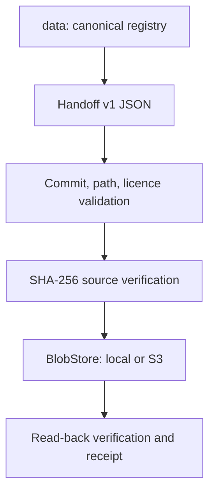

# Canonical registry ingestion (provider-neutral)

This is the runnable consumer of the [canonical data registry's v1 handoff
contract](https://github.com/DiogoRibeiro7/data/blob/main/docs/INGESTION_HANDOFF.md).
The `data` repository owns dataset approval, licensing, source provenance, and
immutable SHA-256 identities. `data-platform-lab` owns execution, local/S3
storage, retries, and operational receipts. It does **not** write to `data`.

## Demonstrate it locally

Prerequisites: Python 3.11+, the installed `data-registry` CLI, and the Python
`data-platform-lab` package (`cd python && poetry install`). The registry
checkout must contain the canonical files and be at the exact Git commit
declared in the handoff. No cloud account or network access is needed during
the consumer run.

1. In an exact checkout of `DiogoRibeiro7/data`, emit the handoff:

   ```bash
   mkdir -p /path/to/data-platform-lab/data/manifests
   cd /path/to/data
   git rev-parse HEAD  # the full pinned commit; record this in the run
   data-registry --root . handoff ons-gross-median-weekly-pay \
     --commit "$(git rev-parse HEAD)" --verify-local --json \
     > /path/to/data-platform-lab/data/manifests/canonical-handoff.json
   ```

   The handoff JSON is an ignored local run artifact, not a file to commit.

2. In `data-platform-lab/python`, ingest the approved bytes:

   ```bash
   data-platform-lab registry-ingest \
     --manifest ../data/manifests/canonical-handoff.json \
     --registry-root /path/to/data \
     --backend local \
     --root ../data/object-store \
     --receipt-dir ../data/manifests
   ```

   The command prints a JSON summary with `files_published`, `files_reused`,
   `bytes_verified`, and `receipt_path`.

3. Run the same command again. The second run should have zero published
   objects and all objects reused. The receipt has a distinct `run_id` and
   retains the source Git commit, source URI/path, license, citation, content
   hash, and destination URI.

## Ingestion trust boundary



The consumer makes these checks **before** claiming success:

- Only v1, redistribution-allowed canonical dataset plans are accepted.
- The source Git repository root and `HEAD` must match the handoff's full
  commit, and each source must match the committed Git blob at that revision.
  A floating `main`, dirty/untracked replacement, arbitrary directory, and
  symlink escape fail.
- Each source URI must be the exact immutable GitHub raw URL, and its relative
  path and storage key must agree with the dataset ID, role, and SHA-256.
- The consumer recomputes the checksum even when the plan says it was locally
  verified. Optional file sizes must also match.
- Existing content-addressed destination objects must match their SHA-256.
  Changed/corrupt destinations are rejected rather than overwritten. New
  objects are read back and verified after publication.
- A success receipt is atomically published *only after all objects complete*.
  On a partial failure, previously verified objects can be reconciled by rerun.
- Receipt and local destination directories are required to remain outside
  the canonical registry checkout.

Receipts go to `data/manifests/` by default and object payloads to
`data/object-store/` by default; both are ignored by Git. Files use stable
keys of the form `canonical/<dataset-id>/<sha256>/<raw-or-derived>/<filename>`.

## Switch storage later

The ingestion logic depends on `BlobStore`, not an individual supplier.
The project's existing `S3BlobStore` supports S3-compatible services including
its local Garage environment. To run against an explicitly configured store:

```bash
data-platform-lab registry-ingest \
  --manifest ../data/manifests/canonical-handoff.json \
  --registry-root /path/to/data \
  --backend s3 \
  --bucket my-data-bucket \
  --endpoint-url https://my-s3-compatible-endpoint.example \
  --key-prefix registry \
  --receipt-dir ../data/manifests
```

Use your platform's normal AWS-compatible credential environment and keep
credentials out of Git. Do not set up a cloud account just to run the local
demo. The receipt preserves the `s3://` destination address and source lineage.

## Scope and operational limits

- **Local checkout only:** The consumer never downloads arbitrary URLs; obtain
  the pinned source Git checkout separately. Source fetch retries and remote
  backfills can be added later behind an explicit source interface.
- **In-memory blob contract:** The current platform's `put_bytes`/`get_bytes`
  reads one object into memory. Large objects should use a future streaming
  `BlobStore` extension with multipart upload and a bounded checksum buffer.
- **Single writer:** A series of objects is not a transaction across stores.
  Parallel workers, concurrent publish coordination, and cleanup of failed
  remote writes need a durable claim/store policy before production use.
- **No transform yet:** This preserves approved Bronze inputs. DuckDB/dbt
  models, quality gates, and analytical serving can consume the verified
  receipt in the next platform slice, still independently of cloud selection.
- **Rights still matter:** Redistribution permission is checked; downstream
  users must keep the source citation and observe the recorded license.

## Verification

```bash
cd python
poetry run pytest tests/test_registry_handoff_ingestion.py -q
poetry run ruff check src/ tests/
poetry run mypy src/
```

Tests use a synthetic Git repository and no network or cloud credentials. They
cover checksum rejection, Git pinning, path traversal, symlink escape, license
gating, duplicate identity, corrupt destinations, idempotent replay, and CLI
receipt lineage.
