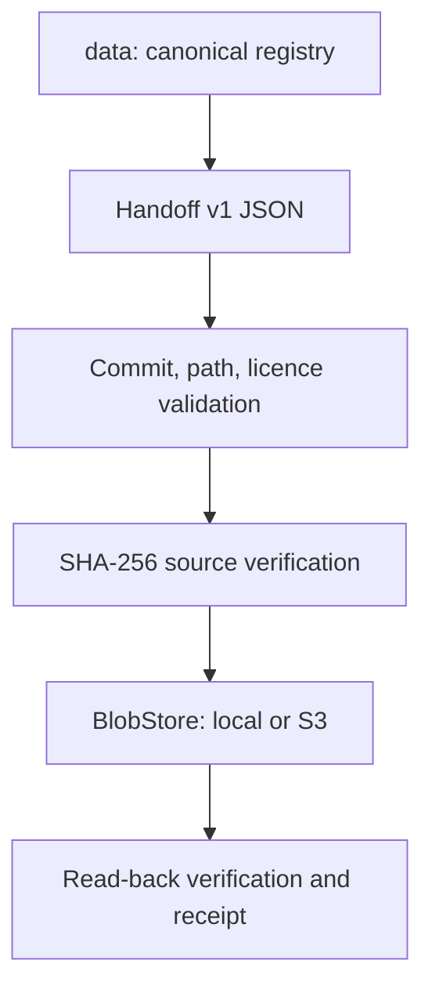

# Canonical registry ingestion (provider-neutral)

This is the runnable consumer of the [canonical data registry's v1 handoff
contract](https://github.com/DiogoRibeiro7/data/blob/main/docs/INGESTION_HANDOFF.md).
The `data` repository owns dataset approval, licensing, source provenance, and
immutable SHA-256 identities. `data-platform-lab` owns execution, local/S3
storage, retries, and operational receipts. It does **not** write to `data`.

## Demonstrate it locally

The consumer supports Python **3.11–3.14**; install the `data-platform-lab` package
with `cd python && poetry install`. Generate handoffs separately with the registry's
`data-registry` CLI in its supported Python **3.12–3.14** environment. That producer
tool is not an ingestion-runtime dependency. In local loading mode, the registry
checkout must contain the canonical files and be at the exact Git commit
declared in the handoff. No cloud account or network access is needed during
the consumer run.

1. In an exact checkout of `DiogoRibeiro7/data`, emit the handoff:

   ```bash
   mkdir -p /path/to/data-platform-lab/data/manifests
   cd /path/to/data
   git rev-parse HEAD  # the full pinned commit; record this in the run
   data-registry --root . handoff ons-gross-median-weekly-pay \
     --commit "$(git rev-parse HEAD)" --verify-local --json \
     > /path/to/data-platform-lab/data/manifests/canonical-handoff.json
   ```

   The handoff JSON is an ignored local run artifact, not a file to commit.

2. In `data-platform-lab/python`, ingest the approved bytes:

   ```bash
   data-platform-lab registry-ingest \
     --manifest ../data/manifests/canonical-handoff.json \
     --registry-root /path/to/data \
     --backend local \
     --root ../data/object-store \
     --receipt-dir ../data/manifests
   ```

   The command prints a JSON summary with `files_published`, `files_reused`,
   `bytes_verified`, and `receipt_path`.

3. Run the same command again. The second run should have zero published
   objects and all objects reused. The receipt has a distinct `run_id` and
   retains the source Git commit, source URI/path, license, citation, content
   hash, and destination URI.

## Extract and load pinned ONS data

The registry is the approved distribution source; ONS is the upstream publisher.
Use `--fetch` to retrieve the exact public GitHub raw objects declared by a trusted
handoff without cloning the registry on the ingestion machine. This is an
**extract-and-load (EL)** step: it preserves original bytes in the object store.
Run the existing ONS transformation afterward for **ELT**, or stop after loading.

| Starting point | Operation |
| --- | --- |
| Trusted handoff, no local source checkout | `registry-ingest --fetch` extracts and loads verified raw objects. |
| Exact local registry checkout | Existing `registry-ingest --registry-root` loads approved local files without network access. |
| Successfully loaded ONS raw objects | `ons-pay-curate` transforms them into validated Silver/Gold Parquet. |
| Already curated and pinned Gold data | `ons-pay-publish` previews or explicitly loads a database using its existing acceptance gate. |

Obtain the handoff from the registry's existing `data-registry handoff` command,
as shown above. A metadata-only handoff is also supported: omit `--verify-local`
when the producer has metadata but no source checkout. The consumer still verifies
every downloaded object's SHA-256. Trust the handoff's provenance and licensing,
and obtain the repository/commit/dataset selection independently of its JSON.
These controls do not authenticate the original ONS publication or sign receipts.

```bash
cd python
export ONS_REGISTRY_COMMIT="<trusted-full-40-character-commit>"

# Read-only preflight: checks pins, manifest and budgets, without fetching bytes.
poetry run data-platform-lab registry-ingest \
  --manifest ../data/manifests/canonical-handoff.json --fetch \
  --registry-repository DiogoRibeiro7/data \
  --registry-commit "$ONS_REGISTRY_COMMIT" \
  --dataset-id ons-gross-median-weekly-pay \
  --dry-run

# Extract, verify and load. The JSON result contains the ingestion receipt path.
poetry run data-platform-lab registry-ingest \
  --manifest ../data/manifests/canonical-handoff.json --fetch \
  --registry-repository DiogoRibeiro7/data \
  --registry-commit "$ONS_REGISTRY_COMMIT" \
  --dataset-id ons-gross-median-weekly-pay \
  --timeout-seconds 30 --max-object-bytes 16777216 --max-total-bytes 67108864 \
  --backend local --root ../data/object-store --receipt-dir ../data/manifests

# Optional transformation: substitute receipt_path from the preceding result.
poetry install --extras analytics
poetry run data-platform-lab ons-pay-curate \
  --receipt ../data/manifests/registry_handoff_ingestion_<run-id>.json \
  --object-root ../data/object-store --output-root ../data
```

The raw load needs no optional analytics or database clients. Transformation uses
the existing ONS model, schema and quality checks; other provider formats will need
their own adapters. Subsequent [database publishing](ons-pay-portable-publishing.md)
remains an explicit action. `--fetch` never creates tables, transforms data,
activates releases, discovers newer upstream versions or updates the registry.
For a combined extraction, loading and transformation batch, use
[`ons-pay-refresh --fetch-source`](ons-pay-refresh.md#extract-load-and-transform-over-https).
It supports ordered historical sources, freshness gates and audited partial recovery.
For reusable source selections, destinations and policies, pass a
[saved refresh job](ons-pay-refresh-jobs.md) to `ons-pay-refresh --job`.
For ordered ONS raw-only batches, add `--load-only` to direct refresh arguments or
set `"load_only": true` in the saved job. This retains verified loading, replay
and partial-failure audits while deferring transformation; see
[load first, transform later](ons-pay-refresh.md#load-raw-data-without-transformation).

### Fetch integrity and operational limits

- Fetching is explicit and accepts only the exact HTTPS `raw.githubusercontent.com`
  URLs bound by the handoff's repository, full commit and canonical source paths.
  Redirects, non-200 responses and HTTP content encodings are rejected. No API
  authentication is configured. Normal local HTTPS/proxy configuration applies.
- A manifest is limited to **1 MiB and 256 objects**. Default transfer budgets are
  **16 MiB per object and 64 MiB per run**; the positive integer byte flags can
  change them. Declared sizes are checked before connecting. Unknown sizes are
  bounded during the read, with at most one overflow-probe byte per failed object.
- Downloads use bounded reads and temporary local storage. Only a complete body
  with matching checksum and optional size can reach the existing loader. The
  current `BlobStore` interface then materializes one bounded object in memory;
  this is not a streaming bulk-storage adapter or a bound on destination reads.
- `--timeout-seconds` accepts positive finite values up to 300. It limits blocking
  socket operations, not the duration of the whole run. The default is one
  attempt per object. Temporary transfer failures can use the explicit
  [bounded retry policy](#retry-temporary-extraction-failures) below.
- Every execution fetches and verifies source bytes again, including replays.
  Matching destinations are reused without rewriting them; corrupt destinations
  fail. A later-object failure can leave earlier verified objects loaded, but
  no success receipt. A rerun reconciles that partial state.
- Successful HTTPS loads keep the existing v1 ingestion receipt and add
  `source_transport: "https"`. Provenance dates remain the registry's source
  dates; receipt timestamps describe this run. No local Git checkout verification
  is claimed in this mode. The existing local mode retains its Git blob checks.
  HTTPS receipts also include `fetch_statistics`: total `attempts`, `retries`
  and `downloaded_bytes` across objects. Downloaded body bytes include discarded
  partial attempts; `bytes_verified` counts only complete verified objects.
- Dry-run validates metadata only. It does not establish remote availability,
  content integrity or destination permissions, and it does not construct a store.
  Use one controlled writer for each selected destination; there is no
  transaction spanning downloads, object storage and the final receipt.

Successful execution or preview exits `0`. Invalid CLI options or fetch preflight
exit `2` with `invalid_arguments`; execution/storage failures exit `1` with the
fixed `ingestion_error` JSON diagnostic. Raw transport exceptions and response
bodies are not printed. `--fetch` and `--registry-root` are mutually exclusive;
fetch identity, limit and dry-run flags cannot silently alter a local load.

The Python API exposes `RegistryFetchOptions`, `plan_registry_fetch` and
`ingest_registry_fetch` in `data_platform_lab.ingestion.registry_fetch`.
It accepts the existing `BlobStore` interface and returns the same `IngestionResult`
as local ingestion. No provider credentials or new runtime dependencies are required.

### Retry temporary extraction failures

Both `registry-ingest --fetch` and `ons-pay-refresh --fetch-source` accept:

```bash
--max-attempts 3 --retry-delay-seconds 1
```

`--max-attempts` is an integer from **1 to 5**, including the initial request;
the default **1** preserves execution without automatic retries.
`--retry-delay-seconds` is a positive finite value up to **30** (default **1**).
The delay doubles after each failed attempt, capped at 30 seconds. Both flags
require HTTPS mode, are validated before connecting, and appear in dry-run output.

Only the current object's GET is retried, always at its exact pinned URL.
Eligible failures are HTTP **408, 429, 500, 502, 503 and 504**, socket timeouts,
connection failures, temporary DNS failure, and an interrupted or demonstrably
truncated response. TLS errors, permanent DNS failure, redirects, other HTTP
statuses, checksum/size mismatches, invalid response headers and exhausted byte
budgets stop immediately. Storage writes and transformation are never retried
by this policy. Earlier successfully loaded objects are not fetched again
within that execution.

For eligible HTTP failures, the policy respects a valid
[`Retry-After`](https://www.rfc-editor.org/rfc/rfc9110.html#name-retry-after)
value expressed as seconds or an HTTP date, waiting at least that long.
If the server requests more than 30 seconds, execution stops for a later
explicit rerun instead of retrying too early. Missing or malformed values use
the exponential delay. No sleep follows the final failed attempt.

Partial bodies are discarded before retrying. Body bytes returned by the HTTP
reader, including partial bytes reported with an interrupted read, consume the
original per-handoff byte budget; retries never reset it. Reserve room for
retransmission when setting `--max-total-bytes` (`--max-source-bytes` in refresh).
Error response bodies are closed without reading or recording their contents.
These are application body-byte limits, excluding headers and TLS traffic.
Attempt and wait caps do not provide a deadline for the entire batch.

Exhausting attempts produces the existing failure exit and no ingestion success
receipt for that handoff. ONS refresh retains earlier completed vintages in its
failure audit. An explicit rerun verifies and reuses their immutable outputs.

A local real-data smoke run on **2026-11-10** fetched the approved ONS source at
registry commit `f407638aa9795b0a71d3bfe92eaf8b3dd344d7ba`, using the checksum in
its [pinned metadata](https://github.com/DiogoRibeiro7/data/blob/f407638aa9795b0a71d3bfe92eaf8b3dd344d7ba/datasets/ons-gross-median-weekly-pay/metadata.yaml).
It verified **894,555 bytes**, reused the object on replay, and curated **7,109
observations** (6,980 numeric pay values and 129 unavailable values). The Gold
outputs contained **93 geography-year rows** and **5,276 local-authority trend
rows**; relational and document publishing plans passed for both. This was a
local extraction/curation check, with no database writes. CI uses synthetic
responses and a loopback redirect server, so public downloads are not required.

## Ingestion trust boundary



The consumer makes these checks **before** claiming success:

- Only v1, redistribution-allowed canonical dataset plans are accepted.
- In local-checkout mode, the source Git repository root and `HEAD` must match the handoff's full
  commit, and each source must match the committed Git blob at that revision.
  A floating `main`, dirty/untracked replacement, arbitrary directory, and
  symlink escape fail.
- Each source URI must be the exact immutable GitHub raw URL, and its relative
  path and storage key must agree with the dataset ID, role, and SHA-256.
- The consumer recomputes the checksum even when the plan says it was locally
  verified. Optional file sizes must also match.
- Existing content-addressed destination objects must match their SHA-256.
  Changed/corrupt destinations are rejected rather than overwritten. New
  objects are read back and verified after publication.
- A success receipt is atomically published *only after all objects complete*.
  On a partial failure, previously verified objects can be reconciled by rerun.
- In local-checkout mode, receipt and local destination directories are required to remain outside
  the canonical registry checkout.

Receipts go to `data/manifests/` by default and object payloads to
`data/object-store/` by default; both are ignored by Git. Files use stable
keys of the form `canonical/<dataset-id>/<sha256>/<raw-or-derived>/<filename>`.

## Switch storage later

The ingestion logic depends on `BlobStore`, not an individual supplier.
The project's existing `S3BlobStore` supports S3-compatible services including
its local Garage environment. To run against an explicitly configured store:

```bash
data-platform-lab registry-ingest \
  --manifest ../data/manifests/canonical-handoff.json \
  --registry-root /path/to/data \
  --backend s3 \
  --bucket my-data-bucket \
  --endpoint-url https://my-s3-compatible-endpoint.example \
  --key-prefix registry \
  --receipt-dir ../data/manifests
```

Use your platform's normal AWS-compatible credential environment and keep
credentials out of Git. Do not set up a cloud account just to run the local
demo. The receipt preserves the `s3://` destination address and source lineage.

## Scope and operational limits

- **Explicit source selection:** Use an exact local checkout or explicitly select
  HTTPS extraction with independently chosen pins. Arbitrary URLs and automatic
  source discovery are not supported. Automatic transfer retries require the
  explicit bounded policy above. ONS historical batches use the
  [refresh workflow](ons-pay-refresh.md).
- **In-memory blob contract:** The current platform's `put_bytes`/`get_bytes`
  reads one object into memory. Large objects should use a future streaming
  `BlobStore` extension with multipart upload and a bounded checksum buffer.
- **Single writer:** A series of objects is not a transaction across stores.
  Parallel workers, concurrent publish coordination, and cleanup of failed
  remote writes need a durable claim/store policy before production use.
- **Verified downstream models:** The existing
  [ONS pay Silver/Gold curation](ons-pay-analytics.md),
  [read-only API](ons-pay-serving.md) and
  [refresh/backfill orchestration](ons-pay-refresh.md) now consume this receipt
  without changing the upstream registry or choosing a cloud supplier.
- **Rights still matter:** Redistribution permission is checked; downstream
  users must keep the source citation and observe the recorded license.

## Verification

```bash
cd python
poetry run pytest tests/test_registry_handoff_ingestion.py tests/test_registry_fetch.py tests/test_registry_fetch_retries.py -q
poetry run ruff check src/ tests/
poetry run mypy src/
```

Tests use a synthetic Git repository and no network or cloud credentials. They
cover checksum rejection, Git pinning, path traversal, symlink escape, license
gating, duplicate identity, corrupt destinations, idempotent replay, and CLI
receipt lineage.
Retry tests also cover transient recovery, permanent failures, server wait hints,
partial-transfer budgets, exhausted batch recovery, both CLIs and a local HTTP
server. No public source access is needed by these tests.
